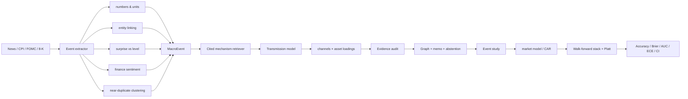
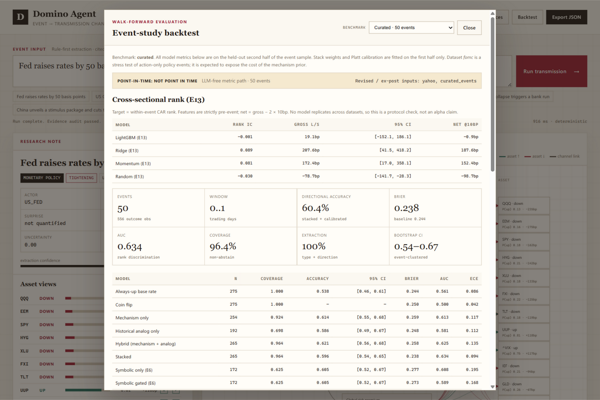

# Domino Agent

[](https://github.com/Puss-M/Domino-Agent/actions/workflows/ci.yml)


**An event-driven macro transmission engine with cited mechanisms, deterministic graph construction, and an event-study backtest.**

Most "AI finance agent" repos stop at prompt orchestration: ask an LLM for a causal chain, draw a graph, call it alpha. That is a shell. Domino Agent v0.2 is a rebuild around three questions a macro desk actually asks:

1. **What happened, and how much of it was a surprise?**
   `50bp` is not the same as `50bp more than priced`. `8.6%` CPI is a level; `+0.3pp vs consensus` is the shock.
2. **Through which channel does it transmit?**
   Real yields, discount rates, the dollar, credit spreads, oil supply, funding liquidity — each with a sign and a citation.
3. **Did that channel actually work?**
   A walk-forward event study on 12 ETFs, with market-model CARs, base-rate and analog baselines, probability calibration, and event-clustered confidence intervals.

The offline path is LLM-free. Every number and every graph edge is produced by typed code; a language model may narrate later, but it cannot invent a mechanism, a sign, or a citation.

<br />


---

## What v0.2 changes

| v0.1 prototype | v0.2 |
|---|---|
| 2 LLM personas (Detective / Reviewer), ~300 LOC | 5 typed stages: extract → retrieve → transmit → audit → report |
| No data layer | 6 source connectors + provenance, caching, retries, point-in-time notes |
| Free-form causal edges | 20 cited mechanisms → 14 channels → 12 assets; every edge has a mechanism ID and references |
| No text normalization | bps/pp/%/$tn/mb/d/Chinese units, surprise vs level, entity linking, LM-style sentiment, near-duplicate clustering |
| No evaluation | 50 dated events, 1-day market-model CAR, walk-forward analog + base rate, stacked ensemble, Platt calibration, event-clustered bootstrap |
| "Reviewer agent" prompt | Deterministic audit: citations, evidence grades, sign conflicts, abstention, look-ahead check |
| Empty frontend | Zero-build dashboard served by FastAPI; run it with one command |

---

## Quick start

### Offline demo (no API key, no network)

```bash
git clone https://github.com/Puss-M/Domino-Agent.git
cd Domino-Agent

py -3.12 -m venv .venv
# Windows: .venv\Scripts\activate
# macOS/Linux: source .venv/bin/activate
pip install -r requirements.txt

uvicorn backend.main:app --reload
```

Open **http://127.0.0.1:8000**. The dashboard runs an example on load. The same engine is available from the CLI:

```bash
python -m backend.app.cli analyze "Fed raises rates by 50 basis points"
python -m backend.app.cli backtest --window-end 1 --out backtest.json
python -m backend.app.cli events
```

### Optional live data

| Variable | Purpose |
|---|---|
| `FRED_API_KEY` | Enables FRED/ALFRED; ALFRED vintages are the only real point-in-time macro path in the project |
| `DOMINO_USER_AGENT` | Override the SEC/HTTP contact string. Use your own contact for SEC bulk work |
| `DOMINO_LM_DICTIONARY` | Path to a licensed Loughran–McDonald CSV; the full dictionary is **not** redistributed |
| `DOMINO_CORS_ORIGINS` | Comma-separated allowed origins (defaults to localhost) |

Refresh the bundled public-data snapshots:

```bash
python scripts/fetch_market_snapshot.py --start 2015-01-01
python scripts/fetch_public_snapshots.py
```

---

## Architecture



Full methodology, formulas and threats to validity: [`docs/methodology.md`](docs/methodology.md).

### The five stages

1. **Extract** (`app/nlp/`): rule-first event typing, direction, actor, magnitude, surprise, entities, sentiment, dedupe. A deterministic parser owns the numbers.
2. **Retrieve** (`app/knowledge/`): match the event against a YAML library of cited transmission mechanisms. Conditions can include or exclude a mechanism (e.g. an emergency cut is not an insurance cut).
3. **Transmit** (`app/reasoning/transmission.py`): mechanism → channel weights → asset loadings. Two layers, signed, with a saturating aggregation so a one-sided asset is not automatically pushed to ±1.
4. **Audit** (`app/reasoning/audit.py`): every edge needs a citation; speculative mechanisms cannot drive a headline; conflicting channels are flagged; an event dated after the analysis as-of time fails the audit.
5. **Evaluate** (`app/evaluation/`): market-model abnormal returns, event-day alignment, walk-forward analog priors, base rates, a stacked ensemble, Platt calibration, and an event-clustered bootstrap.

---

## Why this is not just a prompt wrapper

### 1. Data has provenance, not vibes

`GET /api/data-sources` returns the access pattern, frequency, revision behavior, point-in-time support, license, and caveats for every source.

| Source | What it is used for | Point-in-time? |
|---|---|---|
| **SEC EDGAR** | XBRL company facts, 8-K exhibits, filing text | Partial: `filed` date enables as-filed reconstruction |
| **GDELT 2.0** | Headline discovery and deduplication | No vintage; cache `seendate` |
| **US Treasury** | Daily yield curve | Snapshot |
| **FRED / ALFRED** | Macro series, vintage-aware | **Yes**, via `realtime_start/end` |
| **World Bank** | Annual regime context | No |
| **Yahoo Finance** | Event-window ETF outcomes | No; adjusted closes are revised |

The bundled snapshot makes the backtest reproducible offline. The connectors exist for refresh and extension; they never silently change a reasoning result.

### 2. Financial text processing is explicit

- **Units are normalized at the boundary**: `50bp`, `0.50 percentage points`, `$1.9 trillion`, `2 mb/d`, `200万桶/日`, `50个基点`.
- **Surprise is separated from level**: CPI `8.6%` is a level; `8.6% vs 8.3% expected` is a `+0.3pp` surprise. FOMC decisions carry an explicit surprise direction, not just the policy change.
- **Entities are a controlled vocabulary**, not guessed NER: `Fed/FOMC/美联储 → US_FED`, `OPEC+ → OPEC_PLUS`, `原油 → ENERGY`.
- **Sentiment is finance-aware**: polarity, uncertainty, hawkish/dovish, risk-on/risk-off, negation scope, intensifiers. The shipped lexicon is a small auditable seed; the licensed Loughran–McDonald dictionary can be loaded from your own path.
- **Duplicates are clustered**: syndicated headlines are one story, not 30 independent observations. The cluster reports duplicate count, source diversity and novelty.

### 3. Every edge is evidence-gated

A mechanism in `backend/data/knowledge/mechanisms.yaml` looks like this:

```yaml
- id: MON_TIGHTEN
  title: Hawkish policy surprise lifts real yields and discount rates
  event_types: [monetary_policy]
  directions: [tightening, hawkish_hold]
  none_keywords: [emergency, bank failure, bank run, banking stress, crisis]
  confidence: 0.82
  evidence_grade: A
  channels:
    real_yields: 0.9
    discount_rates: 0.8
    nominal_yields: 0.7
    usd: 0.6
    credit_spreads: 0.3
    risk_premium: 0.2
  citations:
    - "Bernanke & Kuttner (2005), Journal of Finance 60(3)"
    - "Gürkaynak, Sack & Swanson (2005), IJCB"
```

If no mechanism matches, **the engine abstains** instead of writing a plausible story. If a mechanism is only `D`-grade, it cannot drive a headline prediction. If two channels disagree, the asset is flagged as conflicting and its confidence is reduced.

### 4. The evaluation is walk-forward and hard to fool

- **Event window**: the first trading session that can price the news (`0..1`), with weekend/after-close alignment. A 5-day window is reported as robustness.
- **Abnormal return**: market model estimated on `[-120, -21]`, CAR over `[0, +1]`. SPY is evaluated on its raw return because its market-model residual is zero by construction.
- **No look-ahead in analogs**: a prior event only enters the analog pool after its outcome window has fully matured before the current event.
- **Baselines**: always-up asset base rate, coin flip, mechanism-only, analog-only, hybrid, stacked, calibrated.
- **Uncertainty**: bootstrap resamples **events**, not the 12 correlated asset rows per event.
- **Calibration**: Platt scaling is fitted on the first half and evaluated on the second half; ECE and reliability bins are reported.

---

## Results

Primary protocol: **50 events, 12 assets, 1-day announcement window, first half for fitting, second half held out.**

| Model (held-out) | Coverage | Directional accuracy | Brier | AUC | ECE |
|---|---:|---:|---:|---:|---:|
| Always-up base rate | 100% | 53.8% | 0.244 | 0.561 | 0.086 |
| Coin flip | 100% | — | 0.250 | 0.500 | 0.042 |
| Mechanism only | 92.4% | 61.4% | 0.259 | 0.613 | 0.117 |
| Historical analog only | 69.8% | 58.6% | 0.248 | 0.581 | 0.112 |
| Hybrid (mechanism + analog) | 96.4% | 62.1% | 0.258 | 0.625 | 0.135 |
| **Stacked + Platt (headline)** | **96.4%** | **60.4%** | **0.238** | **0.634** | **0.052** |

- 95% event-clustered accuracy interval for the headline model: **0.537–0.668**.
- The mechanism-only model is more accurate than the calibrated stack but **overconfident**; calibration buys a better Brier score and a much lower ECE at a small accuracy cost. This trade-off is shown, not hidden.
- 5-day robustness: headline accuracy **54.5%**, Brier **0.252**, AUC **0.528**. The edge is concentrated in the announcement session; the 5-day horizon is noisier.
- Extraction: **50/50** joint event-type + direction on the curated sample. This is in-sample vocabulary coverage, not an out-of-distribution benchmark.

Per-asset and per-event-type breakdowns, calibration bins and failure cases are in [`docs/evaluation.md`](docs/evaluation.md). The backtest is reproducible:

```bash
python -m backend.app.cli backtest --window-end 1 --out backtest.json
```



---

## What this is not

- **Not identified causal inference.** The output is a transmission hypothesis with a citation, not an ATE from a randomized intervention. DoWhy/EconML-style identification is out of scope.
- **Not a trading strategy.** The event study is an evaluation harness; it does not model transaction costs, slippage, capacity, borrow, or execution.
- **Not a point-in-time price database.** Yahoo adjusted closes are revised. The event labels are editorial. A production version would use CRSP/Compustat or a vendor with vintages.
- **Not a large-sample result.** 50 events, overlapping windows, 12 correlated assets. The bootstrap is clustered by event, but the sample is still small.
- **Mechanism priors were authored by the project, not preregistered.** They are theory- and literature-informed, not fitted to the test outcomes. That is weaker than a preregistered specification and should be read that way.

---

## Repository layout

```
backend/
  app/
    nlp/            # numbers, entities, sentiment, dedupe, event extractor
    knowledge/      # mechanism loader, retrieval
    reasoning/      # transmission, audit, memo, orchestration
    evaluation/     # event study, analog model, metrics, backtest
    datasources/    # SEC, GDELT, Treasury, FRED, World Bank, Yahoo
    api.py          # FastAPI surface
    cli.py          # offline CLI
  data/
    events/         # 50 dated, labelled events
    knowledge/      # 20 mechanisms, 14 channels
    market/         # reproducible ETF price snapshot + provenance
    macro/ sec/ news/  # small public-data snapshots
frontend/           # zero-build dashboard (HTML/CSS/JS + SVG)
tests/              # 79 unit/contract tests
docs/               # methodology, data sources, evaluation, resume bullets
```

---

## Related work and what was borrowed

- **TradingAgents** (TauricResearch): role-separated analysts/researchers/risk team. Domino keeps the separation but makes each role a typed contract instead of a free-form persona.
- **FinRobot** (AI4Finance): the principle “models reason, software computes, agents orchestrate, systems verify.” Domino follows it: deterministic transmission, LLM-free offline path, provenance on every output.
- **FinGPT** (AI4Finance): finance-specific sentiment and data pipelines. Domino's lexicon is a small seed plus an optional licensed LM dictionary, not a redistributed copy.
- **AI Hedge Fund** (virattt): the discipline of a backtest and a paper-trading ledger. Domino borrows the evaluation discipline, not the persona zoo.
- **BettaFish / 微舆**: multi-agent public-opinion analysis. Domino is the macro-transmission and evidence-audit counterpart, not another social-listening dashboard.
- **DoWhy / EconML**: a reminder to distinguish a causal *claim* from a causal *graph*. Domino explicitly declines to claim identification.

---

## Resume-ready bullets

See [`docs/resume_bullets.md`](docs/resume_bullets.md) for Chinese and English versions, plus interview talking points.

**English (condensed):**

> Built a five-stage event-driven macro transmission engine (rule-first extraction → cited mechanism retrieval → deterministic channel/asset graph → evidence audit → memo), with 20 cited mechanisms, 14 channels, 50 dated events and 79 tests; runs fully offline with no API key.
>
> Implemented finance-aware text normalization (bps vs percentage points vs percent, `$tn`, `mb/d`, Chinese units, surprise vs level), entity linking, LM-style sentiment with negation, and near-duplicate news clustering; added provenance-aware connectors for SEC EDGAR/XBRL, GDELT, Treasury, FRED/ALFRED, World Bank and Yahoo.
>
> Built a walk-forward event study on 12 ETFs (market-model CAR, weekend/after-close alignment, event-clustered bootstrap, base-rate/analog/mechanism baselines, stacked ensemble, Platt calibration): **60.4% directional accuracy vs 53.8% base rate, Brier 0.238 vs 0.244, AUC 0.634, 96.4% coverage** on the held-out half.

---

## Development

```bash
pip install -r requirements.txt
ruff check . --select E9,F --extend-exclude frontend
pytest -q
```

CI runs both on Python 3.12. See [`CONTRIBUTING.md`](CONTRIBUTING.md) for adding a mechanism or an event.

## License

MIT. Data snapshots retain the terms of their providers; see [`docs/data_sources.md`](docs/data_sources.md).
