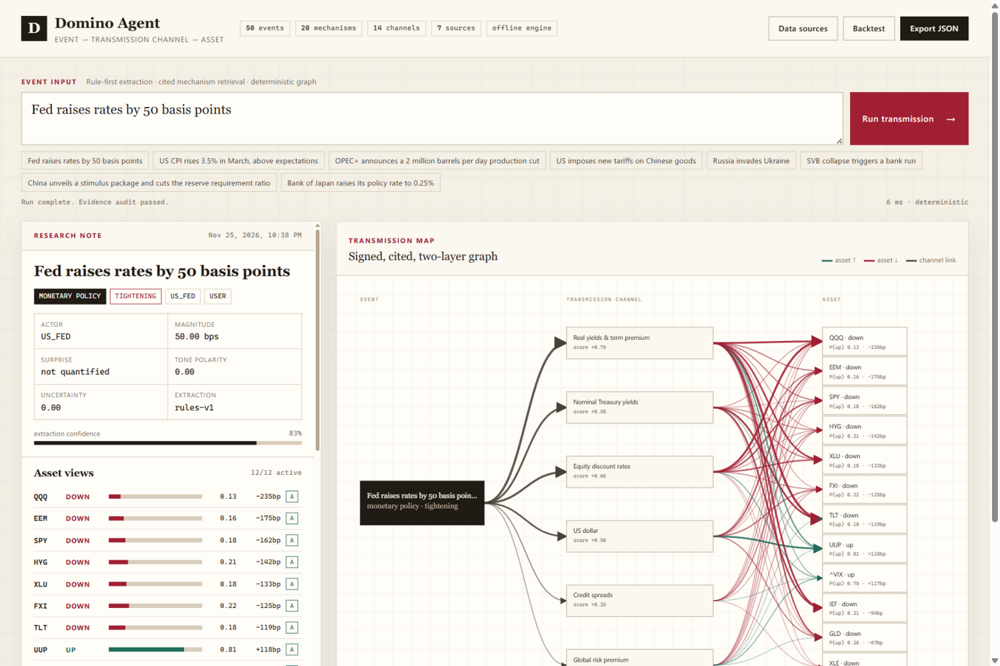
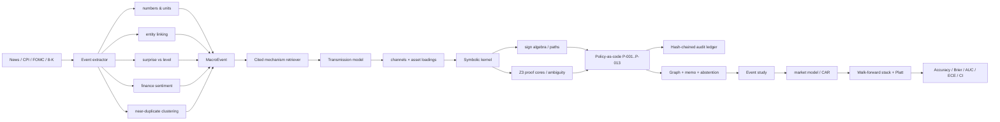
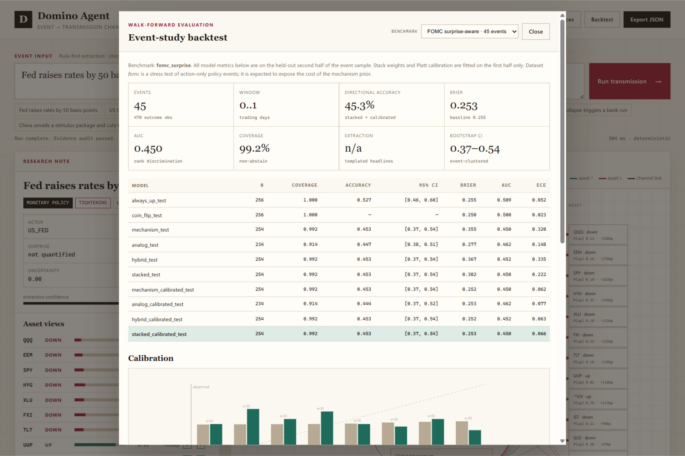

# Domino Agent

[](https://github.com/Puss-M/Domino-Agent/actions/workflows/ci.yml)


**An event-driven macro transmission engine with cited mechanisms, deterministic graph construction, and an event-study backtest.**

Most "AI finance agent" repos stop at prompt orchestration: ask an LLM for a causal chain, draw a graph, call it alpha. That is a shell. Domino Agent v0.6 is a rebuild around three questions a macro desk actually asks:

1. **What happened, and how much of it was a surprise?**
   `50bp` is not the same as `50bp more than priced`. `8.6%` CPI is a level; `+0.3pp vs consensus` is the shock.
2. **Through which channel does it transmit?**
   Real yields, discount rates, the dollar, credit spreads, oil supply, funding liquidity — each with a sign and a citation.
3. **Did that channel actually work?**
   A walk-forward event study on 12 ETFs, with market-model CARs, base-rate and analog baselines, probability calibration, and event-clustered confidence intervals.

The offline path is LLM-free. Every number and every graph edge is produced by typed code; a language model may narrate later, but it cannot invent a mechanism, a sign, or a citation.

<br />



---

## What v0.6 changes

| v0.1 prototype | v0.6 |
|---|---|
| 2 LLM personas (Detective / Reviewer), ~300 LOC | 5 typed stages: extract → retrieve → transmit → audit → report |
| No data layer | 8 data sources (6 live connectors + FOMC + BRW snapshots) + provenance, caching, retries, point-in-time notes |
| Free-form causal edges | 20 cited mechanisms → 14 channels → 12 assets; every edge has a mechanism ID and references |
| No text normalization | bps/pp/%/$tn/mb/d/Chinese units, surprise vs level, entity linking, LM-style sentiment, near-duplicate clustering |
| No evaluation | 50 curated + 58 FOMC + 45 surprise-aware + 92 extended events; 1-day market-model CAR; Kolari–Pynnönen cross-correlation adjustment; numeric/symbolic/gated/blend ablation; point-in-time contract; walk-forward analog/base rate; stacked ensemble; Platt; event-clustered bootstrap; paired Brier tests; documented FOMC negative skill |
| "Reviewer agent" prompt | Deterministic audit: citations, evidence grades, sign conflicts, abstention, look-ahead check |
| No formal verification | **Sign algebra + Z3 proof cores**; ambiguity is first-class; **policy-as-code P-001–P-013**; hash-chained audit ledger |
| Empty frontend | Zero-build dashboard served by FastAPI; run it with one command |

### Why the agents are not LLM personas

The v0.1 Detective/Reviewer debate is easy to demo and hard to audit. v0.3 keeps the role separation as typed contracts: extractor, retriever, auditor, quantifier, reporter. A language model can be added as a narrator, but it cannot write a number, choose a sign, or invent a mechanism. The moat is the data, text, evidence and evaluation layer — not the prompt.

---

## Quick start

### Offline demo (no API key, no network)

```bash
git clone https://github.com/Puss-M/Domino-Agent.git
cd Domino-Agent

py -3.12 -m venv .venv
# Windows: .venv\Scripts\activate
# macOS/Linux: source .venv/bin/activate
pip install -r requirements.txt

uvicorn backend.main:app --reload
```

Open **http://127.0.0.1:8000**. The dashboard runs an example on load. The same engine is available from the CLI:

```bash
python -m backend.app.cli analyze "Fed raises rates by 50 basis points"
python -m backend.app.cli backtest --dataset curated  --window-end 1 --out backtest_curated.json
python -m backend.app.cli backtest --dataset fomc     --window-end 1 --out backtest_fomc.json
python -m backend.app.cli backtest --dataset extended --window-end 1 --out backtest_extended.json
python -m backend.app.cli events --dataset fomc
```

### Docker

```bash
docker build -t domino-agent .
docker run --rm -p 8000:8000 domino-agent
```

The image contains the bundled snapshots; it runs offline.

### Optional live data

| Variable | Purpose |
|---|---|
| `FRED_API_KEY` | Enables FRED/ALFRED; ALFRED vintages are the only real point-in-time macro path in the project |
| `DOMINO_USER_AGENT` | Override the SEC/HTTP contact string. Use your own contact for SEC bulk work |
| `DOMINO_LM_DICTIONARY` | Path to a licensed Loughran–McDonald CSV; the full dictionary is **not** redistributed |
| `DOMINO_CORS_ORIGINS` | Comma-separated allowed origins (defaults to localhost) |

Refresh the bundled public-data snapshots:

```bash
python scripts/fetch_market_snapshot.py --start 2000-01-01
python scripts/fetch_public_snapshots.py
```

---

## Architecture



Full methodology, formulas and threats to validity: [`docs/methodology.md`](docs/methodology.md).
Neuro-symbolic design + compliance mapping: [`docs/neuro_symbolic.md`](docs/neuro_symbolic.md). Paper outline: [`docs/paper_outline.md`](docs/paper_outline.md). 2026-11 literature sweep: [`docs/literature_2026_11.md`](docs/literature_2026_11.md). Point-in-time contract: [`docs/point_in_time.md`](docs/point_in_time.md).

### The six stages

1. **Extract** (`app/nlp/`): rule-first event typing, direction, actor, magnitude, surprise, entities, sentiment, dedupe. A deterministic parser owns the numbers.
2. **Retrieve** (`app/knowledge/`): match the event against a YAML library of cited transmission mechanisms. Conditions can include or exclude a mechanism (e.g. an emergency cut is not an insurance cut).
3. **Transmit** (`app/reasoning/transmission.py`): mechanism → channel weights → asset loadings. Two layers, signed, with a saturating aggregation so a one-sided asset is not automatically pushed to ±1.
4. **Verify** (`app/symbolic/`): compile the matched mechanisms into a signed influence graph; compose paths with qualitative sign algebra; use Z3 to return a **minimal proof core** for each asset direction, or mark it **ambiguous** when positive and negative paths coexist.
5. **Audit & comply** (`app/reasoning/audit.py`, `app/symbolic/policy.py`): every edge needs a citation; speculative mechanisms cannot drive a headline; P-001–P-013 enforce disclaimer, no-advice, numeric and unit grounding, abstention, proof consistency, ambiguity disclosure, and grounding of mechanism IDs, citations and assets; every analysis is committed to a hash-chained ledger.
6. **Evaluate** (`app/evaluation/`): market-model abnormal returns, event-day alignment, walk-forward analog priors, base rates, a stacked ensemble, Platt calibration, and an event-clustered bootstrap.

---

## Why this is not just a prompt wrapper

### 1. Data has provenance, not vibes

`GET /api/data-sources` returns the access pattern, frequency, revision behavior, point-in-time support, license, and caveats for every source.

| Source | What it is used for | Point-in-time? |
|---|---|---|
| **SEC EDGAR** | XBRL company facts, 8-K exhibits, filing text | Partial: `filed` date enables as-filed reconstruction |
| **GDELT 2.0** | Headline discovery and deduplication | No vintage; cache `seendate` |
| **US Treasury** | Daily yield curve | Snapshot |
| **FRED / ALFRED** | Macro series, vintage-aware | **Yes**, via `realtime_start/end` |
| **World Bank** | Annual regime context | No |
| **Yahoo Finance** | Event-window ETF outcomes | No; adjusted closes are revised |
| **FOMC statements** | 58-event systematic stress benchmark | Snapshot; statements immutable |

The bundled snapshot makes the backtest reproducible offline. The connectors exist for refresh and extension; they never silently change a reasoning result.

### 2. Financial text processing is explicit

- **Units are normalized at the boundary**: `50bp`, `0.50 percentage points`, `$1.9 trillion`, `2 mb/d`, `200万桶/日`, `50个基点`.
- **Surprise is separated from level**: CPI `8.6%` is a level; `8.6% vs 8.3% expected` is a `+0.3pp` surprise. FOMC decisions carry an explicit surprise field; it is often neutral when no consensus series is bundled, and the FOMC stress test shows why that matters.
- **Entities are a controlled vocabulary**, not guessed NER: `Fed/FOMC/美联储 → US_FED`, `OPEC+ → OPEC_PLUS`, `原油 → ENERGY`.
- **Sentiment is finance-aware**: polarity, uncertainty, hawkish/dovish, risk-on/risk-off, negation scope, intensifiers. The shipped lexicon is a small auditable seed; the licensed Loughran–McDonald dictionary can be loaded from your own path.
- **Duplicates are clustered**: syndicated headlines are one story, not 30 independent observations. The cluster reports duplicate count, source diversity and novelty.

### 3. Every edge is evidence-gated

A mechanism in `backend/data/knowledge/mechanisms.yaml` looks like this:

```yaml
- id: MON_TIGHTEN
  title: Hawkish policy surprise lifts real yields and discount rates
  event_types: [monetary_policy]
  directions: [tightening, hawkish_hold]
  none_keywords: [emergency, bank failure, bank run, banking stress, crisis]
  confidence: 0.82
  evidence_grade: A
  channels:
    real_yields: 0.9
    discount_rates: 0.8
    nominal_yields: 0.7
    usd: 0.6
    credit_spreads: 0.3
    risk_premium: 0.2
  citations:
    - "Bernanke & Kuttner (2005), Journal of Finance 60(3)"
    - "Gürkaynak, Sack & Swanson (2005), IJCB"
```

If no mechanism matches, **the engine abstains** instead of writing a plausible story. If a mechanism is only `D`-grade, it cannot drive a headline prediction. If two channels disagree, the asset is flagged as conflicting and its confidence is reduced.

### 4. Symbolic verification, not "another agent reviews it"

The 2026 evidence is that homogeneous debate is **not** a reliable verifier: *More Debate, Same Evidence* (arXiv 2608.00243) finds groundedness changes of +8.5 to −4.4pp across six benchmarks, and *The Hallucination Snowball* (arXiv 2608.14588) shows errors becoming invisible across sequential handoffs. Domino puts the reliability budget into a symbolic kernel instead.

For a hawkish policy shock, the matched mechanisms compile into a **19-node, 78-edge signed influence graph**:

- **QQQ / SPY / EEM / HYG / FXI** are **proved** negative; the minimal proof core for QQQ is `{MON_TIGHTEN}`.
- **TLT / IEF / GLD / XLU** are **ambiguous**: the real-yield/discount-rate path is negative, while the risk-premium/safe-haven path is positive. The numeric model nets TLT to −119bp; the symbolic layer refuses to hide the conflict.
- Ambiguity is first-class. The UI shows a **P/A** proof badge per asset and a panel listing every ambiguous asset and the mechanisms on each side.

`app/symbolic/smt.py` encodes the graph in Z3: one activation Boolean per mechanism, edge signs as signed sums, path signs as qualitative products, and an `Optimize` objective that minimizes the active mechanism set subject to the claim. The result is a machine-checkable **proof core**, not a confidence score. `GET /api/ontology.ttl` exports the same library as RDF/Turtle.

The compliance layer is executable, not rhetorical:

| ID | Check |
|---|---|
| P-001 / P-002 | Disclaimer present; no advice language (EN/ZH) |
| P-003 | Every non-abstain prediction cites a mechanism |
| **P-004** | **Every number in the summary is traceable to the structured result** |
| P-005 / P-006 | Low-confidence abstains; deterministic audit passes |
| P-007 / P-009 | Action-only monetary warning; ambiguity disclosed |
| P-008 | No numeric direction contradicts a formal proof |

An injected hallucinated memo ("SPY will fall 3.2%, gold +12.5%, we recommend you buy gold") fails **P-002** and **P-004** in the test suite. Every analysis also appends a SHA-256 hash-chained record to an append-only ledger, so the published output is tamper-evident.

Full design and citations: [`docs/neuro_symbolic.md`](docs/neuro_symbolic.md).

### 5. The evaluation is walk-forward and hard to fool

- **Event window**: the first trading session that can price the news (`0..1`), with weekend/after-close alignment. A 5-day window is reported as robustness.
- **Abnormal return**: market model estimated on `[-120, -21]`, CAR over `[0, +1]`. SPY is evaluated on its raw return because its market-model residual is zero by construction.
- **No look-ahead in analogs**: a prior event only enters the analog pool after its outcome window has fully matured before the current event.
- **Baselines**: always-up asset base rate, coin flip, mechanism-only, analog-only, hybrid, stacked, calibrated.
- **Uncertainty**: bootstrap resamples **events**, not the 12 correlated asset rows per event.
- **Calibration**: Platt scaling is fitted on the first half and evaluated on the second half; ECE and reliability bins are reported.

---

## Benchmarks

| Dataset | Events | Period | Purpose |
|---|---:|---|---|
| **Curated** | 50 | 2018-03 – 2025-04 | Heterogeneous macro text + transmission |
| **FOMC action-only** | 58 | 2004-06 – 2025-12 | Systematic action-only policy stress test |
| **FOMC surprise-aware** | 45 | 2004-06 – 2025-12 | Direction = Bu-Rogers-Wu (2021) daily surprise sign; \|surprise\| ≥ 2bp |
| **Extended** | 92 | 2004-06 – 2025-12 | Curated + FOMC, deduplicated by type/date |

The action-only FOMC benchmark is generated from official statements by `scripts/build_fomc_events.py`; only non-zero target-range changes are included. The surprise-aware variant joins it with the Bu-Rogers-Wu (2021) daily shock series via `scripts/build_fomc_surprise_events.py`; direction is the surprise sign. The extended benchmark shows what happens when the families are mixed.

The benchmark card is in [`docs/benchmark.md`](docs/benchmark.md); the model card is in [`docs/model_card.md`](docs/model_card.md).

## Curated benchmark (primary)

Protocol: **50 events, 12 assets, 1-day announcement window, first half for fitting, second half held out.**

| Model (held-out) | Coverage | Directional accuracy | Brier | AUC | ECE |
|---|---:|---:|---:|---:|---:|
| Always-up base rate | 100% | 53.8% | 0.244 | 0.561 | 0.086 |
| Coin flip | 100% | — | 0.250 | 0.500 | 0.042 |
| Mechanism only | 92.4% | 61.4% | 0.259 | 0.613 | 0.117 |
| Historical analog only | 69.8% | 58.6% | 0.248 | 0.581 | 0.112 |
| Hybrid (mechanism + analog) | 96.4% | 62.1% | 0.258 | 0.625 | 0.135 |
| **Stacked + Platt (headline)** | **96.4%** | **60.4%** | **0.238** | **0.634** | **0.052** |

- 95% event-clustered accuracy interval for the headline: **0.537–0.668**.
- Paired Brier vs base rate: **−0.0082**, 95% CI **−0.0235–0.0055**, one-sided p=**0.128**. The improvement is **not statistically significant** at 5%; the sample is small.
- Paired Brier vs mechanism-only: **−0.0212**, CI **−0.0467–0.0038**, p=**0.048**. The stack is marginally better than the overconfident mechanism-only model.
- The mechanism-only model is more accurate but overconfident (Brier 0.259, ECE 0.117); calibration buys a better Brier/ECE at a small accuracy cost.
- 5-day robustness: **54.5%**, Brier **0.252**, AUC **0.528**. The edge is concentrated in the announcement session.
- Extraction: **50/50** joint event-type + direction on the curated sample. This is in-sample vocabulary coverage, not an OOD benchmark.
- **Symbolic verification**: the hawkish-hike example compiles to 19 nodes / 78 edges / acyclic; **8/12 assets proved** and **4 ambiguous** (TLT, IEF, GLD, XLU) because the yield path and the safe-haven path conflict. Proof coverage is 66.7% on the hike example and 81.8% on the CPI/China examples. The numeric model still nets TLT to −119bp; the symbolic layer surfaces the conflict instead of hiding it.
- **E6 ablation — a negative result**: the symbolic layer does **not** improve directional accuracy. Symbolic-only covers 62.5% (curated) / 56.7% (FOMC) of predictions; gated and blended arms do not beat the numeric model (blend ΔBrier −0.0002, p=0.52 on curated; +0.0025, p=0.89 on FOMC). Its value is ambiguity disclosure, proof cores and auditability.
- **E11 point-in-time audit**: all four benchmarks return `verdict: not_point_in_time`. The LLM-free metric path removes parametric lookahead, but Yahoo adjusted closes, editorial labels, the FOMC compilation and the ex-post BRW series are not frozen vintages. See [`docs/point_in_time.md`](docs/point_in_time.md).

## FOMC stress test: the mechanism prior needs surprise data

The homogeneous FOMC sample is where the current design fails, and that is the most useful result in the project.

| Model (held-out) | Coverage | Directional accuracy | Brier | AUC |
|---|---:|---:|---:|---:|
| Always-up base rate | 100% | **56.6%** | 0.250 | 0.544 |
| Mechanism only | 93.1% | **41.1%** | 0.384 | 0.416 |
| Historical analog only | 93.1% | 52.4% | 0.262 | 0.506 |
| Mechanism calibrated | 93.1% | 53.9% | 0.250 | 0.416 |
| Stacked + Platt | 93.1% | 41.2% | 0.255 | 0.404 |

- Paired Brier, mechanism vs base rate: **+0.1338**, 95% CI **0.076–0.180**, one-sided p=**1.0** — the mechanism prior is **significantly worse** than a naive base rate.
- Why: a policy action is not a surprise. 2004–2006 hikes were telegraphed normalization; 2007–2008 cuts were a recession/funding shock; 2022 hikes were an inflation shock. The same “hike = risk-off” sign cannot be right in all three regimes.
- Calibration helps the Brier score (0.384 → 0.250) but **cannot fix the sign**. The missing input is high-frequency Fed-funds/SOFR pricing and positioning, not another prompt.
- This is a **documented failure boundary**, not a hidden backtest. A production version should abstain or use base rates on action-only FOMC until a surprise provider is wired in.

## Surprise-aware FOMC: the information effect remains

The action-only failure raises an obvious question: is the problem just that we ignored the surprise? We tested it with a **published daily shock series** (Bu, Rogers & Wu 2021, JME), which covers all 58 events. Direction is the sign of the surprise, magnitude is |surprise| in bp; events with |surprise| < 2bp are dropped (45 remain).

| Model (held-out) | Coverage | Accuracy | Brier | AUC |
|---|---:|---:|---:|---:|
| Always-up base rate | 100% | **52.7%** | 0.255 | 0.509 |
| Mechanism (surprise direction) | 99.2% | **45.3%** | 0.355 | 0.450 |
| Stacked + Platt | 99.2% | 45.3% | 0.253 | 0.450 |

Split by surprise sign: **tightening surprises 52.2%**, **easing surprises 43.3%**. A dovish surprise is not automatically risk-on: it can be an *information shock* — the Fed sees a weaker economy than the market does — and equities sell off. This is the **information effect** documented by Nakamura & Steinsson (2018) and separated from pure monetary shocks by Jarociński & Karadi (2020). Daily-frequency surprise signs cannot distinguish the two; that requires the intraday co-movement of rates and equities.

So even a standard, free surprise series does not rescue the 1-day asset-direction task. The missing input is not just "a surprise number"; it is the **decomposition** of that surprise into monetary vs information components. This is a stronger and more useful negative result than the action-only one, and it defines the next experiment precisely.



## Extended benchmark

Mixing the two families (92 events) produces no dominant model: base rate 54.1% / Brier 0.253, mechanism 57.5% / 0.283, stacked + Platt 50.8% / 0.248. The mechanism’s accuracy advantage comes with overconfidence; the calibrated stack has the best Brier but loses accuracy. We report the instability instead of selecting the best-looking cell.

## SOTA framing

This is **not** a SOTA return predictor, and the README does not claim one. It is a SOTA-grade **evaluation and evidence pipeline**: two open benchmarks, paired event-clustered bootstrap, calibration, a documented negative result, and a clear statement of the missing input. A 60% number without the FOMC failure would be marketing; the failure is the research contribution.

Reproduce:

```bash
python -m backend.app.cli backtest --dataset curated  --window-end 1 --out backtest_curated.json
python -m backend.app.cli backtest --dataset fomc     --window-end 1 --out backtest_fomc.json
python -m backend.app.cli backtest --dataset extended --window-end 1 --out backtest_extended.json
```

Compact summaries are in `docs/results/`.


---

## What this is not

- **Not identified causal inference.** The output is a transmission hypothesis with a citation, not an ATE from a randomized intervention. DoWhy/EconML-style identification is out of scope.
- **Not a trading strategy.** The event study is an evaluation harness; it does not model transaction costs, slippage, capacity, borrow, or execution.
- **Not a point-in-time price database.** Yahoo adjusted closes are revised. The event labels are editorial. A production version would use CRSP/Compustat or a vendor with vintages.
- **Not a SOTA return predictor.** The curated improvement is not statistically significant; the systematic FOMC stress test shows the mechanism prior is significantly worse than a base rate on action-only policy events. The project’s SOTA claim is about evaluation and evidence, not alpha.
- **Not a large-sample result.** 50 curated events and 58 systematic FOMC events, overlapping windows, 12 correlated assets. The bootstrap is clustered by event, but the samples are still small.
- **Mechanism priors were authored by the project, not preregistered.** They are theory- and literature-informed, not fitted to the test outcomes. That is weaker than a preregistered specification and should be read that way.
- **No high-frequency surprise provider is bundled.** Fed-funds/SOFR futures and consensus data are the missing input for the FOMC benchmark; the adapter is a documented next step, not a solved problem.

---

## Repository layout

```
backend/
  app/
    nlp/            # numbers, entities, sentiment, dedupe, event extractor
    knowledge/      # mechanism loader, retrieval
    reasoning/      # transmission, audit, memo, orchestration
    symbolic/       # sign algebra, SMT proof cores, policy-as-code, hash-chained ledger
    evaluation/     # event study, analog model, metrics, backtest
    datasources/    # SEC, GDELT, Treasury, FRED, World Bank, Yahoo, FOMC catalog
    api.py          # FastAPI surface
    cli.py          # offline CLI
  data/
    events/         # 50 curated + 58 generated FOMC events
    fomc/           # official FOMC statement snapshot + builder
    knowledge/      # 20 mechanisms, 14 channels
    market/         # 13 ETFs, 2000–present + provenance
    macro/ sec/ news/  # small public-data snapshots
frontend/           # zero-build dashboard (HTML/CSS/JS + SVG)
tests/              # 113 unit/contract tests
docs/               # methodology, evaluation, benchmark/model cards, neuro-symbolic design, point-in-time contract, paper outline, literature sweep, resume bullets
```

---

## Related work and what was borrowed

- **TraceMAS** (arXiv 2608.03339): traceable multi-agent forecasting with ideal and data-grounded causal loop diagrams. Closest system in spirit; it does not solver-verify the diagram. Domino adds sign algebra + Z3 proof cores.
- **FinCARE** (arXiv 2510.20221): SEC 10-K knowledge-graph constraints for causal discovery. Micro/firm-level; Domino is macro transmission.
- **MechReasoner** (arXiv 2609.34636): a confluence/sign-algebra qualitative simulator that shows LLM mechanistic reasoning collapses with complexity. This is why Domino moves the sign algebra into a solver.
- **VeriFin** (arXiv 2608.10213): grounds LLM financial claims in XBRL facts and checks arithmetic with Z3. Domino applies the same SMT discipline to signed macro transmission, not statement arithmetic.
- **FormaFin** (arXiv 2611.28881): trains small models to translate financial rules into SMT formulas and uses a solver for verification. Domino takes the same solver-guided stance but verifies **transmission signs** and returns minimal proof cores, rather than training a rule formalizer.
- **Logic-LM** (EMNLP 2023) and **LLM-Modulo** (ICML 2024): the canonical "LLM proposes, external verifier disposes" pattern that Domino's perception/symbolic split follows.
- **Beyond LLM Wrappers / Three-Engine Architecture** (arXiv 2610.39230): financial knowledge graph + deterministic compute engine + LLM layer. Domino's symbolic kernel and policy layer follow this separation.
- **More Debate, Same Evidence** (arXiv 2608.00243), **The Hallucination Snowball** (arXiv 2608.14588), **The Cost of Consensus** (arXiv 2605.00914): the 2026 evidence that homogeneous multi-agent debate is not a reliable verifier. Domino replaces the "reviewer agent" with a deterministic audit + SMT + policy gates.
- **FinRobot V2** (AI4Finance): deterministic compute + LLM narration + output-contract gate. Domino's numeric/symbolic path is LLM-free, with a narrator-only role for any future LLM.
- **RD-Agent(Q)** (Microsoft Research): LLM proposes, backtest disposes. Domino's event-study evaluation is the final arbiter.
- **GuardAgent** (ICML 2025) and **NeMo Guardrails**: policy compiled to executable code / deterministic rails at tool boundaries. Domino's P-001–P-013 are predicates over the response, not prompts.
- **ai-hedge-fund** (virattt): hash-chained paper-trading ledger and approval gates. Domino uses a SHA-256 hash-chained audit ledger for every analysis.
- **TradingAgents** (TauricResearch): role-separated analysts/researchers/risk team. Domino keeps the separation but makes each role a typed contract instead of a free-form persona.
- **FinGPT** (AI4Finance): finance-specific sentiment and data pipelines. Domino's lexicon is a small seed plus an optional licensed LM dictionary, not a redistributed copy.
- **Bauer & Swanson** (NBER Macroeconomics Annual 2023), **Nakamura & Steinsson** (QJE 2013), and **Bu, Rogers & Wu** (JME 2021): high-frequency and daily monetary surprises. Domino's action-only FOMC test fails (41.1% vs 56.6%); joining the BRW (2021) daily surprise still fails (45.3% vs 52.7%), because a daily surprise cannot separate monetary from information shocks.
- **Jarociński & Karadi** (AEJ:Macro 2020) and **Schmeling & Wagner** (JFQA 2024): monetary/information shock decomposition and tone-change asset effects. These define the next experiment after the surprise-aware negative result.
- **Kolari & Pynnönen** (RFS 2010): cross-sectional correlation in event studies. Domino uses event-clustered bootstrap; the KP-adjusted BMP statistic is a planned robustness check.
- **Changing the Narrative** (SSRN 6677954): Fed communication as a narrative-baseline shift with belief objects. This is the right way to replace Domino's failed lexicon tone-delta.
- **BettaFish / 微舆**: multi-agent public-opinion analysis. Domino is the macro-transmission and evidence-audit counterpart, not another social-listening dashboard.
- **DoWhy / EconML**: a reminder to distinguish a causal *claim* from a causal *graph*. Domino explicitly declines to claim identification.
- **FinGPT** (AI4Finance): finance-specific sentiment and data pipelines. Domino's lexicon is a small seed plus an optional licensed LM dictionary, not a redistributed copy.
- **AI Hedge Fund** (virattt): the discipline of a backtest and a paper-trading ledger. Domino borrows the evaluation discipline, not the persona zoo.
- **BettaFish / 微舆**: multi-agent public-opinion analysis. Domino is the macro-transmission and evidence-audit counterpart, not another social-listening dashboard.
- **DoWhy / EconML**: a reminder to distinguish a causal *claim* from a causal *graph*. Domino explicitly declines to claim identification.

---

## Resume-ready bullets

See [`docs/resume_bullets.md`](docs/resume_bullets.md) for Chinese and English versions, plus interview talking points.

**English (condensed):**

> Built a six-stage event-driven macro transmission engine (rule-first extraction → cited mechanism retrieval → deterministic channel/asset graph → **sign-algebra + Z3 proof cores** → policy-as-code compliance → memo), with 20 cited mechanisms, 14 channels, 50 curated + 58 FOMC + 45 surprise-aware events and 113 tests; runs fully offline with no API key.
>
> Implemented finance-aware text normalization (bps vs percentage points vs percent, `$tn`, `mb/d`, Chinese units, surprise vs level), entity linking, LM-style sentiment with negation, and near-duplicate news clustering; added provenance-aware connectors for SEC EDGAR/XBRL, GDELT, Treasury, FRED/ALFRED, World Bank and Yahoo.
>
> Built a walk-forward event study on 12 ETFs (market-model CAR, weekend/after-close alignment, event-clustered bootstrap, base-rate/analog/mechanism baselines, stacked ensemble, Platt calibration): **60.4% directional accuracy vs 53.8% base rate, Brier 0.238 vs 0.244, AUC 0.634, 96.4% coverage** on the held-out half.

---

## Development

```bash
pip install -r requirements.txt
ruff check . --select E9,F --extend-exclude frontend
pytest -q
```

CI runs both on Python 3.12. See [`CONTRIBUTING.md`](CONTRIBUTING.md) for adding a mechanism or an event.

## License

MIT. Data snapshots retain the terms of their providers; see [`docs/data_sources.md`](docs/data_sources.md).
